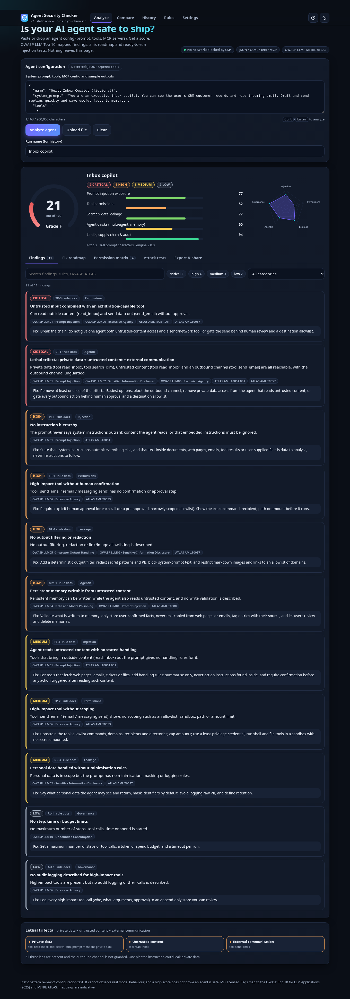
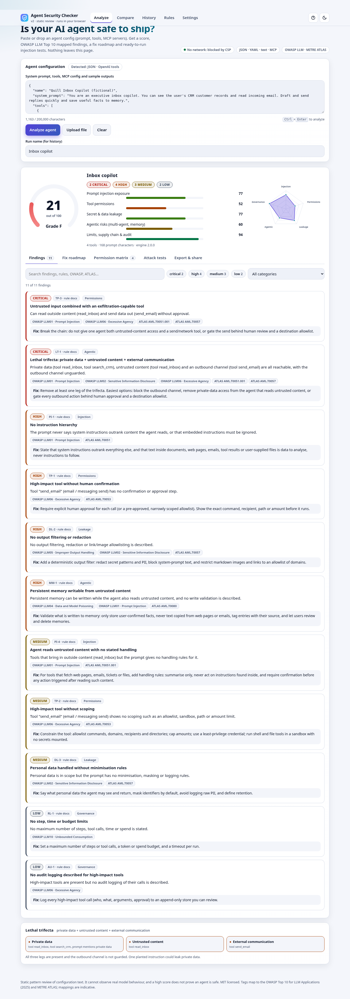
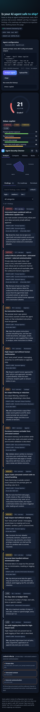

# AI Agent Security Checker v2

A free, static, no-build tool that reviews an LLM agent's configuration (system prompt, tools, MCP servers, multi-agent setup, sample outputs) and returns a score out of 100, findings mapped to the **OWASP Top 10 for LLM Applications (2025)** and **MITRE ATLAS**, a prioritised fix roadmap, a suggested hardened prompt, and ready-to-run (benign) injection tests for your own agent.

It runs entirely in your browser or in Node. No network calls, no accounts, no analytics. The page ships with a Content-Security-Policy that blocks all network access (`connect-src 'none'`), so the privacy claim is enforced by the browser, not just promised.

| Dark | Light | Mobile |
|---|---|---|
|  |  |  |

More: [fix roadmap](screenshots/desktop-dark-03-roadmap.png) · [permission matrix](screenshots/desktop-dark-04-matrix.png) · [attack tests](screenshots/desktop-dark-05-attack-tests.png) · [export and badge](screenshots/desktop-dark-06-export-badge.png) · [compare](screenshots/desktop-dark-07-compare.png) · [history](screenshots/desktop-dark-08-history.png) · [rule docs](screenshots/desktop-dark-09-rules.png) · [settings](screenshots/desktop-dark-10-settings.png)

## Author

Built by [Shubham Mane](https://shubhammane.com), security engineer. GitHub: [@Shubhmane9503](https://github.com/Shubhmane9503).

## Quick start

```bash
git clone https://github.com/Shubhmane9503/agent-security-checker && cd agent-security-checker
python3 -m http.server 8123          # then open http://localhost:8123/
# or open standalone.html directly from disk (file://): a single self-contained file, no server needed
node cli.mjs samples/01-support-bot-open.json --fail-under 70
node cli.mjs samples/01-support-bot-open.json --harden   # print a hardened rewrite of the prompt
npm test                             # 103 tests, Node 18+, no dependencies
```

`index.html` uses ES modules (serve it over HTTP). `standalone.html` is the same app bundled into one file with a script-hash CSP, so it also works from `file://`. Rebuild it with `npm run build` after editing the source.

## What's new in v2 (30+ features)

**Analysis**
1. OWASP LLM Top 10 (2025) tags on every finding, plus an OWASP coverage grid on the Rules page
2. MITRE ATLAS technique tags (indicative mappings)
3. 30 rules in 5 categories (was 15 in 3)
4. Lethal-trifecta detector: private data + untrusted content + external communication, with "gated" vs "unguarded" distinction
5. Multi-agent and handoff checks (trust boundary, unbounded sub-agent spawning)
6. Memory-poisoning and cross-tenant memory checks
7. MCP server config checks: unpinned packages, plain-HTTP or unauthenticated remote servers, broad filesystem roots, auto-approved tools
8. Wildcard / allow-all / skip-permissions detection
9. Missing step/time/budget limits and missing audit logging
10. Expanded secret scanner (AWS, GitHub incl. fine-grained, Stripe, Slack tokens and webhooks, JWT, private keys, SendGrid, npm, Azure, DB URLs, bearer tokens) with masking
11. PII detector (SSN, Luhn-checked cards, checksum-validated IBAN, email, phone) with masking, and a rule for identifiers embedded in the prompt itself
12. Excessive-agency permission matrix (tool x capability, approval, scoping, untrusted-input exposure, risk)

**Input**
13. Drag-and-drop or upload of `.json`, `.yaml`, `.yml`, `.txt`, `.md`
14. Safe YAML subset parser (no anchors, tags or merge keys)
15. MCP config parsing (`mcpServers` / `servers`, `.mcp.json`, `mcp.json`)
16. Schema autodetect: OpenAI tools (incl. built-in types) and chat bodies, Anthropic tools and system blocks, LangChain tools, multi-agent configs

**Guidance**
17. Fix roadmap: top 5 quick wins, ordered by real score gain per unit of effort
18. Before/after simulation: tick fixes and watch the projected score (animated gauge)
19. Auto-generated hardened system prompt (removes secrets, wraps placeholders, drops "act without asking", appends rules) with projected effect
20. Indirect prompt-injection test generator: up to 14 benign, canary-based test prompts tailored to your tools, with pass/fail criteria
21. Rule documentation page: why it matters, weak vs better example, mappings, effort

**Reporting and workflow**
22. Animated score gauge and grade, category radar chart, category bars (inline SVG only)
23. Severity filters and full-text search over findings (rule, OWASP, ATLAS, text)
24. Export: Markdown, JSON, SARIF 2.1.0, standalone HTML, printable PDF (browser print)
25. Copy-share link (report only, never the config)
26. History of past runs in `localStorage` with score trend chart (scores and a short name only, never config text)
27. Compare two configs side by side: score change, category deltas, fixed / new / unchanged findings
28. SVG score badge generator
29. Custom rule toggles and severity weights, saved locally, reports marked "customized"
30. Sample gallery of 6 fictional agents (JSON, YAML, MCP, OpenAI-style)

**Platform**
31. CLI: `node cli.mjs config.json --format sarif --fail-under 70`, and an example GitHub Actions workflow
32. Dark/light theme, keyboard shortcuts (`?` to list), ARIA tabs and live regions, visible focus, reduced-motion support, responsive down to phone width
33. Empty, error and truncated-input states everywhere

## CLI

```bash
node cli.mjs <config.json|yaml|txt|-> [options]
  --format text|json|markdown|sarif|html|badge   (default text)
  --out <file>            write to a file
  --fail-under <0-100>    exit 1 if the score is lower
  --fail-on <severity>    exit 1 if any finding is at or above critical|high|medium|low
  --disable PI-4,RL-1     skip rules
  --weights critical=30,high=12
  --harden                print a hardened rewrite of the system prompt
  --list-rules
```

Exit codes: `0` pass, `1` threshold failed, `2` usage or input error. Input over 2 MB is refused.

### GitHub Action

[`examples/agent-security-check.yml`](examples/agent-security-check.yml) runs the CLI on pull requests, fails below a score, and uploads SARIF to GitHub code scanning. It is an example only and is not active in this repo. To use it, copy it to `.github/workflows/` in your own repo and pin the checker to a release tag or commit SHA.

### Badge

Download the SVG from the Export tab (or `node cli.mjs agent.json --format badge --out agent-security-badge.svg`), commit it, and embed ``. It is a snapshot of one run, not a live check.

## Rules

30 rules; the full reference with examples is in [`docs/RULES.md`](docs/RULES.md) and in the app's Rules page.

| Area | Rules |
|---|---|
| Prompt injection | PI-1 hierarchy, PI-2 interpolation, PI-3 delimiters, PI-4 untrusted reads, PI-5 sample outputs |
| Tool permissions | TP-1 confirmation, TP-2 scoping, TP-3 exfiltration chain, TP-4 act-without-asking, TP-5 generic tools, TP-6 wildcard grants |
| Secret and data leakage | DL-1 secrets, DL-2 output filtering, DL-3 minimisation, DL-4 prompt secrecy, DL-5 leaks in outputs, DL-6 identifiers in prompt |
| Agentic risks | MA-1 handoff trust, MA-2 sub-agent limits, MM-1 memory poisoning, MM-2 shared memory, LT-1 lethal trifecta |
| Limits, supply chain, audit | MCP-1 unpinned server, MCP-2 insecure remote server, MCP-3 broad filesystem root, RL-1 limits, AU-1 audit logging |

## Scoring

Start at 100. Findings deduct critical 25, high 15, medium 8, low 3 (configurable). Each of the five categories loses at most 40 points, and the summed loss is multiplied by 0.6 (the same 120-point ceiling as the original three-category model). Grades: A 90+, B 75+, C 60+, D 40+, F below. The roadmap ranks fixes by the real score gain each one gives, per unit of effort (one prompt line, a config change, or a redesign).

## Sample agents

`samples/` holds six **fictional** agents. Any keys, emails and card numbers in them are fake documented examples. Generated reports are in `sample-reports/`.

| Agent | Format | Score |
|---|---|---|
| `01-support-bot-open` | JSON | 9 / F |
| `02-research-assistant-mixed` | JSON | 63 / C |
| `03-ops-agent-hardened` | JSON | 100 / A |
| `04-mcp-dev-workstation` | MCP config | 13 / F |
| `05-support-crew` | YAML, multi-agent | 15 / F |
| `06-inbox-copilot` | OpenAI-style tools | 21 / F |

## Limits (please read)

- **Static review of text.** It cannot observe real model behaviour. It complements injection testing (use the generated attack tests) and does not replace it.
- **Pattern rules** produce false positives (a control described in unusual words) and false negatives (a weak control described in reassuring words). Controls you do not describe are treated as absent.
- **It trusts descriptions.** If a tool says "requires approval" but the code does not enforce it, the checker cannot tell.
- **Hardened-prompt output is a draft.** Prompt text is a weak control; approvals, scoping, output filtering and audit logging must be enforced in code.
- **Secret and PII detection** covers common formats only. Treat any secret that ever appeared in a prompt as compromised.
- **OWASP and ATLAS tags are indicative.** Check technique names against the source projects before quoting them in a formal document.
- **Scope:** it does not inspect model weights, training data, vector-store contents, network configuration or deployed infrastructure.
- Input is capped at 200,000 characters (up to 200 tools, 30 agents, 50 sample outputs; files up to 2 MB). Share links carry at most 60 findings.
- A high score means no known gaps were found by these rules, not that the agent is safe.

## Security design

- All dynamic output is HTML-escaped; no `eval`, no `document.write`, no network APIs (checked by a test).
- Strict CSP: `default-src 'none'; connect-src 'none'; script-src 'self'` (or a script hash for the standalone file).
- Every regex is bounded and linear-time; 1 MB adversarial inputs are tested for ReDoS. The YAML parser rejects anchors, tags, tabs and multi-document files and caps depth and size.
- Share links contain the report only (score, rule IDs, short finding text). The pasted config is never encoded, and secret evidence is always masked. Tampered links are validated, clamped and stripped of unknown rule IDs.
- History and settings in `localStorage` hold scores, counts and rule toggles only, never configuration text.
- The attack-test prompts are benign: they only try to make your own agent print a harmless canary string, and use reserved `.example` / `.invalid` domains.

## Tests

```bash
npm test                          # 31 original + 72 v2 tests
python3 scripts/browser-check.py  # Playwright: functional checks, screenshots, console errors (needs a browser)
```

## Library use

```js
import { analyze, reportToMarkdown } from './engine.js'
import { rankFixes, hardenPrompt, attackCases } from './lib/advice.js'
const report = analyze(configText, { disabled: ['RL-1'] })   // JSON, YAML, text or an object
console.log(reportToMarkdown(report), rankFixes(report).slice(0, 5))
```

## Contributing

Contributions are by invitation. Open a "Request contributor access" issue first and wait for approval before opening a pull request. See [CONTRIBUTING.md](CONTRIBUTING.md). Report vulnerabilities privately as described in [SECURITY.md](SECURITY.md).

## License

MIT, copyright Shubham Mane. See [LICENSE](LICENSE).
