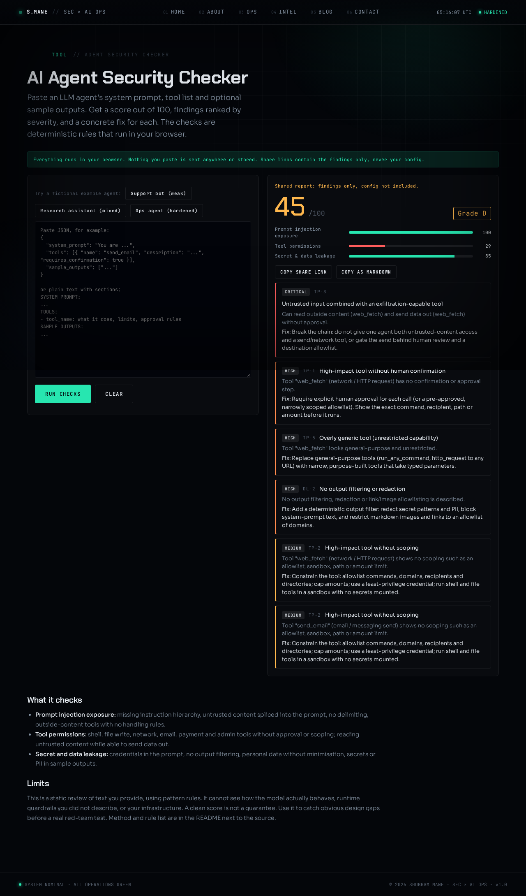

# AI Agent Security Checker

A free, client-side tool that reviews an LLM agent's configuration for common design weaknesses and gives a score out of 100, findings ranked by severity, and a concrete fix for each.

**Privacy:** the checks run in your browser. No network calls, no accounts, nothing stored. A share link encodes the *report* (score, finding IDs, short detail text) in the URL hash. The pasted config is never encoded, and secret evidence is masked.



## What it checks

| ID | Area | What it looks for | Severity |
|---|---|---|---|
| PI-1 | Prompt injection | No statement that system instructions outrank content, or that embedded instructions must be ignored | high |
| PI-2 | Prompt injection | Template placeholders (`{{ticket_body}}`, `${page}`) splicing external text into the prompt | high |
| PI-3 | Prompt injection | Untrusted content with no delimiters, or delimiters without a "data only" rule | high / medium |
| PI-4 | Prompt injection | Tools that ingest web, email, tickets or files with no handling rules | medium |
| PI-5 | Prompt injection | Sample outputs showing injection phrasing or prompt disclosure | high |
| TP-1 | Permissions | Shell, payment, file write, email, network, DB write or admin tool with no confirmation | critical / high |
| TP-2 | Permissions | Same tools with no scoping (allowlist, sandbox, path or amount limit) | high / medium |
| TP-3 | Permissions | Agent can read untrusted content and send data out without approval | critical |
| TP-4 | Permissions | Prompt says to act without asking for confirmation | high / medium |
| TP-5 | Permissions | General-purpose, unrestricted tools ("run any command") | high |
| DL-1 | Leakage | API keys, tokens, private keys, DB URLs or passwords in the prompt or tool config | critical |
| DL-2 | Leakage | No output filtering, redaction or link and image allowlisting | high / medium |
| DL-3 | Leakage | Personal data in scope with no minimisation or masking rules | medium |
| DL-4 | Leakage | "Do not reveal" wording as the only protection | low |
| DL-5 | Leakage | Secrets, emails, SSNs, Luhn-valid card numbers or phone numbers in sample outputs | critical / high |

## Method

1. **Parse** the input. Accepts JSON (`system_prompt`, `tools`, `sample_outputs`; OpenAI-style `function` tools also work) or plain text with `SYSTEM PROMPT:`, `TOOLS:`, `SAMPLE OUTPUTS:` sections.
2. **Classify tools** by name and description into shell, payment, file write, email, network, DB write and admin. Read-only tools are skipped.
3. **Apply rules.** Each rule is a deterministic regex or structural test in `engine.js`. The rule catalog (title and fix text) is in the same file.
4. **Score.** Start at 100. Deductions are critical 25, high 15, medium 8, low 3. Each of the three areas loses at most 40 points, so the lowest score is 0. Grades: A 90+, B 75+, C 60+, D 40+, F below.
5. **Share.** The report is serialised, base64url-encoded and placed in `#r=…`. Opening such a link rebuilds the report from the built-in catalog; findings text is limited to the short details, and unknown IDs are dropped.

## Limits

- It is a static review of text. It cannot observe real model behaviour, so it complements prompt-injection testing and does not replace it.
- Pattern rules produce false positives (a scoped tool described in unusual words) and false negatives (a weak control described in reassuring words). Controls you do not describe are treated as absent.
- It trusts descriptions. If a tool is described as "requires approval" but the code does not enforce it, the checker cannot tell.
- Secret detection covers common formats only. Treat any secret that ever appeared in a prompt as compromised.
- It does not model multi-agent setups, MCP server trust, memory poisoning or supply-chain issues.
- Input is capped at 200,000 characters (up to 200 tools and 50 sample outputs); anything beyond that is ignored. Share links carry at most 60 findings.
- A high score means no known gaps were found by these rules, not that the agent is safe.

## Sample agents

`samples/` holds three **fictional** agents invented for demonstration. Any keys, emails and card numbers in them are fake test values. Generated reports are in `sample-reports/`.

| Agent | Score |
|---|---|
| `01-support-bot-open.json` (weak) | 0 / F |
| `02-research-assistant-mixed.json` (mixed) | 45 / D |
| `03-ops-agent-hardened.json` (hardened) | 100 / A |

## Try it

The demo is a single static page with no build step. From the repo root:

```bash
python3 -m http.server 8080      # or any static file server
# open http://localhost:8080/
```

Click one of the three fictional sample agents, or paste your own agent configuration (JSON, or plain text with `SYSTEM PROMPT:`, `TOOLS:` and `SAMPLE OUTPUTS:` sections) and press **Check agent**. Everything runs in the browser.

## Usage

```bash
npm test                 # 31 deterministic tests against the samples (Node 18+, no dependencies)
npm run reports          # regenerate sample-reports/
```

The engine is a plain ES module with no dependencies, so it also works in Node:

```js
import { analyze, reportToMarkdown } from './engine.js'
console.log(reportToMarkdown(analyze(JSON.stringify(config))))
```

Share links: `encodeReport(report)` returns a base64url string holding the report only (never the config). Append it to a page URL as `#r=...` and rebuild it with `decodeReport`.

## License

MIT
